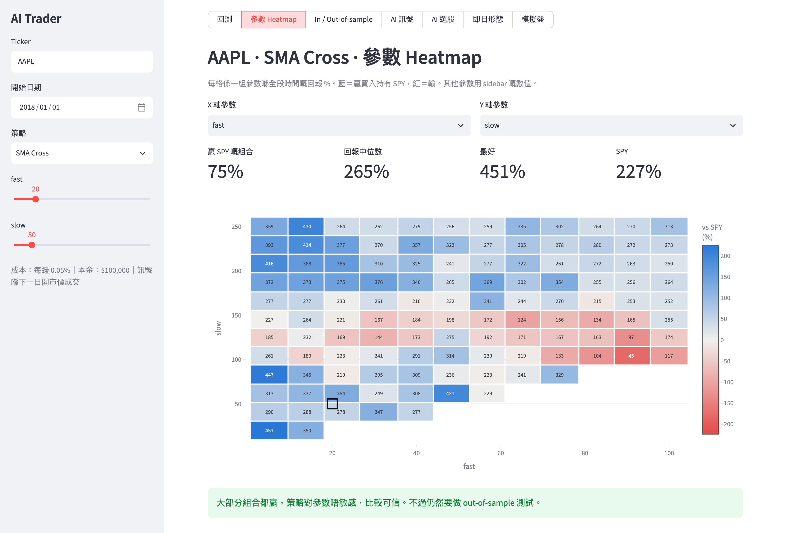
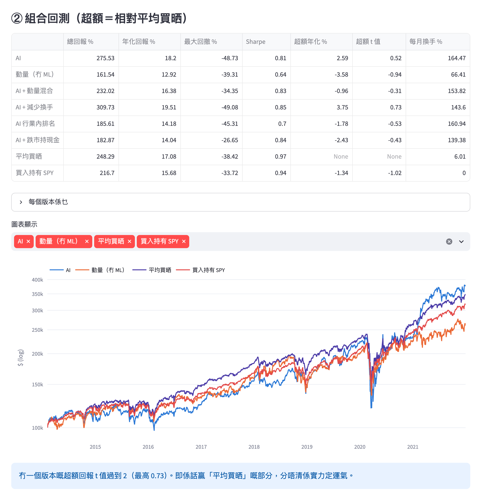
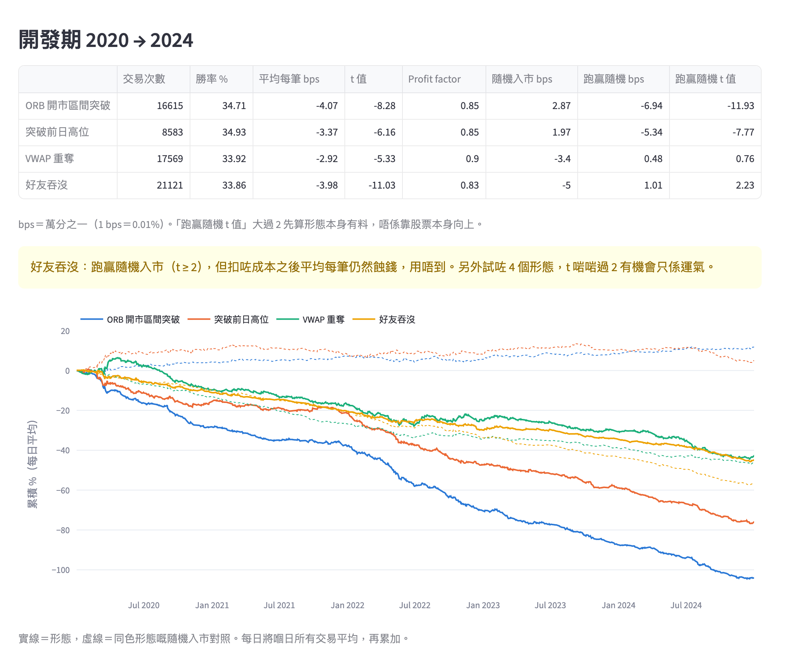

# AI Trader — testing whether price-based signals beat the US stock market

**English** | [廣東話](README.zh-HK.md)

A personal research project: an end-to-end system that backtests trading ideas on US stocks, tries to break them with out-of-sample tests, and trades the survivors on an [Alpaca](https://alpaca.markets) **paper** (simulated money) account.

## Goal

Find out whether signals built from public price and volume data — classic chart rules, machine-learning stock rankings, and intraday candlestick patterns — can beat simple benchmarks (buy-and-hold SPY, or an equal-weight portfolio) **after trading costs**, using tests strict enough that a lucky backtest can't pass.

## Method

- **No look-ahead.** Signals are computed at the close and filled at the next bar's open. Every backtest charges costs (5 bps per side for daily strategies, 2 bps per side intraday).
- **Overfitting checks.** Parameter heatmaps (is the result a broad plateau or one lucky cell?), in-sample vs out-of-sample splits, and walk-forward ML training with a purge gap, so a model never sees data from its own test period.
- **Lockbox.** The final years of data are held out: 2022 onward for stock selection, 2025 onward for intraday. Methods are chosen on the development period only, and the lockbox is opened once at the end.
- **Pre-registration and multiple-testing control.** The intraday pattern scan's pass/fail rules were written down before any results were seen ([`intraday/PREREGISTRATION.md`](intraday/PREREGISTRATION.md)). Results are corrected with Benjamini–Hochberg (FDR 5%) across all 91 hypotheses, or Bonferroni for the two follow-up hypotheses.
- **Fair baselines.** Every pattern trade is paired with a random entry in the same stock on the same day with the same exit rules, and every stock picker is compared with an equal-weight portfolio of the same universe. This separates "the pattern works" from "the stock just went up".
- **Survivorship-bias fix.** The S&P 500 universe uses each company's index inclusion date, so the model can't pick a stock before it joined the index.

## Conclusion

**No robust edge survived.** With public price and volume data on large, liquid US stocks, nothing tested makes money reliably after costs:

| Experiment | Result |
|---|---|
| Daily ML direction signal (10 stocks, walk-forward) | AUC ≈ 0.50, no better than a coin flip |
| S&P 500 ML stock picker (Ridge, Gradient Boosting; 6 portfolio variants; 2014 →) | Information coefficient ≈ 0; no variant beats equal-weight with excess-return t > 2 |
| 4 intraday patterns (ORB, previous-day-high breakout, VWAP reclaim, bullish engulfing; 64k trades, 2020–2024) | All lose 3–4 bps per trade after costs; both breakout patterns do *worse* than random entry (t = −11.9, −7.8) |
| Full scan: 61 TA-Lib candlestick patterns × long/short + the 4 above (91 hypotheses, ~1.09M trades, 2020–2024) | 0 of 91 pass the pre-registered test |
| Follow-up: short the breakouts (lockbox 2025 →) | Beats random shorting (t = 5.8, 4.1) but still loses 4–5 bps per trade after costs, so it fails |

A negative result is still a result: the pipeline is built to reject false positives, and it did. The same discipline — out-of-sample, lockbox, pre-registered rules, multiple-testing correction — is what would make a *positive* finding believable.

**Paper trading.** Three Alpaca paper accounts compare an ML + momentum blend (top 20 stocks), pure momentum (top 20) and equal-weight, rebalanced monthly from GitHub Actions. Risk controls include a kill switch, a 5% max daily loss, 10% max position size, a cash buffer, and a SQLite trade journal. The code only connects to paper accounts (`paper=True` is hard-coded). This public copy has no keys and runs no scheduled jobs.

## Dashboard

Streamlit dashboard (the UI is in Cantonese; captions below explain each view).

**Parameter heatmap — overfitting check.** Each cell is the total return of one SMA-crossover parameter pair on AAPL; blue beats buy-and-hold SPY, red loses. A strategy is only trusted if good results form a broad region rather than an isolated cell, and if the shape survives an out-of-sample split (a separate tab).



**ML stock picker — portfolio backtest.** Monthly walk-forward ranking of the S&P 500, holding the top 20, development period 2014–2021. The table compares six variants against equal-weight (平均買晒) and SPY. The best excess-return t-stat is 0.73: the outperformance is indistinguishable from luck.



**Intraday patterns vs random entry.** Cumulative P&L of four intraday patterns on 25 liquid stocks and ETFs (5-minute bars, 2020–2024, after 2 bps per side). Solid lines are the patterns; dashed lines are random entries with identical exits. Every pattern trends down, and the two breakout patterns (blue, orange) lose far more than random.



## Tech stack

Python · pandas · NumPy · scikit-learn · backtesting.py · TA-Lib · Streamlit · Plotly · Alpaca API (alpaca-py) · yfinance · SQLite · GitHub Actions

## Repository layout

| Path | Purpose |
|---|---|
| `data/` | Daily bars (yfinance) with on-disk cache |
| `strategies/`, `backtest/` | Baseline strategies, backtest engine, parameter grids, in/out-of-sample tests |
| `ml/` | Features, walk-forward training, S&P 500 universe with inclusion dates, cross-sectional stock picker |
| `intraday/` | 5-minute SIP bars from Alpaca, pattern rules, random-entry backtests, full TA-Lib scan, pre-registration |
| `trader/` | Alpaca paper broker, target portfolio, risk checks, SQLite journal, monthly rebalance |
| `app/` | Streamlit dashboard, with a read-only, password-protected mode for sharing |
| `.github/workflows/` | Monthly rebalance job (manual trigger only in this public copy) |

## Run it

```bash
python3 -m venv .venv && .venv/bin/pip install -r requirements.txt
.venv/bin/streamlit run app/dashboard.py                  # dashboard at http://localhost:8501
.venv/bin/python -m ml.pick --k 20                        # stock picker, development period only
.venv/bin/python -m trader.run preview --offline          # preview this month's orders without any API key
```

The intraday research and the paper-trading commands need free Alpaca paper API keys in `.env` (see `.env.example`). The full pattern scan also needs TA-Lib: `pip install -r requirements-research.txt`.

---

Research and education only. Not investment advice.
